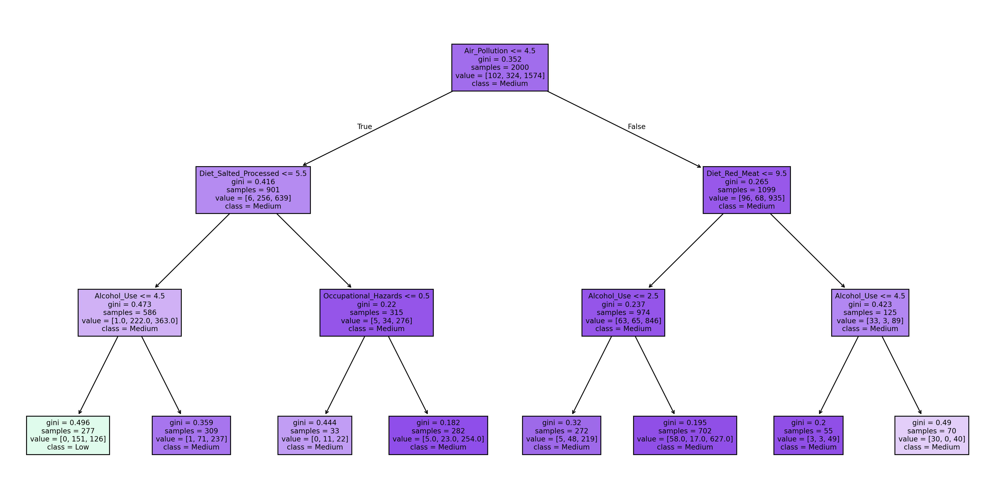

# 01 - Evaluación y Cálculo de Peso

## ¿Qué hace este programa?

La información etiquetada, el cálculo de riesgo peso ya está registrado.
Por tal razón, si bien no hace parte del análisis, sí se considera que es 
importante saber esos valores cómo fueron calculados para saber el origen 
de sus valores.

En otras palabras: aquí descubrimos de dónde sale el peso de cada factor.

## ¿Cómo lo hace?

1.  Carga el archivo `cancer-risk-factors.csv`
2.  Limpia lo que no debe ser pista: quita `Patient_ID`, `Risk_Level`, 
    `Overall_Risk_Score` y `Cancer_Type`
3.  Convierte los Sí/No en 1/0 con `get_dummies`
4.  Entrena un `RandomForestClassifier` para calcular el peso 
    (`feature_importances_`) de cada campo
5.  Entrena un arbolito `DecisionTreeClassifier(max_depth=3)` para 
    mostrar la fórmula de forma visual

## Resultado

*   Tabla con los pesos secretos de la fórmula, ordenados de mayor a menor
*   Imagen `arbol_decision.png` con el árbol que explica la decisión

## Gráfica

## Archivos

*   `Calculo_criterios_evaluacion.ipynb` - Programa principal
*   `arbol_decision.png` - Árbol de decisión generado
