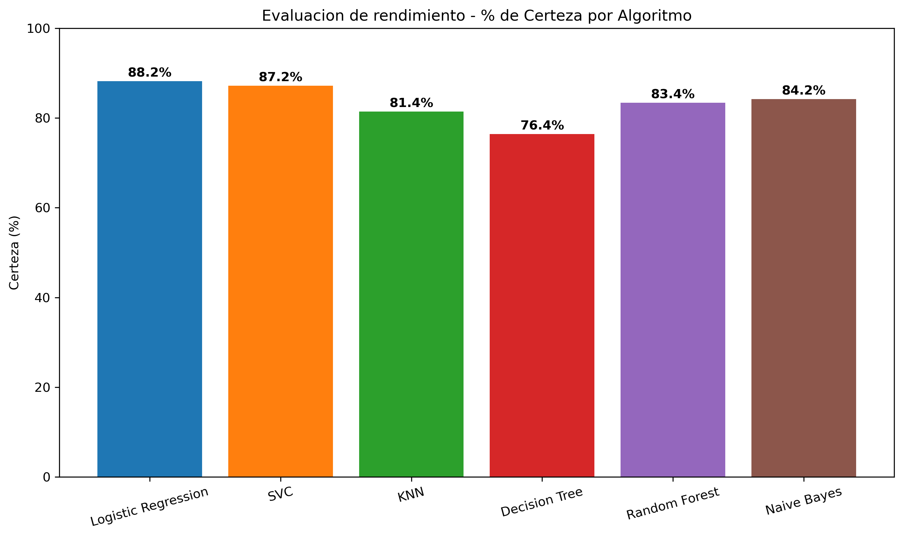

# 02 - Métricas de Rendimiento

## ¿Qué hace este programa?

Dada la información obtenida en internet sobre factores de riesgo de cáncer,
se hacen los siguientes pasos. Es importante aclarar que en esta evaluación
de datos se maneja información etiquetada.

El propósito es medir la certeza de cada algoritmo y presentarla para 
seleccionar el algoritmo que será o serán seleccionados como candidatos.

## ¿Cómo lo hace?

1.  Carga la información `cancer-risk-factors.csv`
2.  Divide la información: 75% para entrenamiento y 25% para evaluación
    *   1500 datos para entrenar
    *   500 datos para evaluar
3.  Evalúa la información con los algoritmos especializados en datos 
    etiquetados:
    *   3.1 Regresión Logística
    *   3.2 SVC
    *   3.3 KNN
    *   3.4 Árbol de Decisiones
    *   3.5 Random Forest
    *   3.6 Naive Bayes
4.  Mide las métricas de rendimiento: calcula la certeza `%` de cada 
    algoritmo con `accuracy_score`

## Resultado

*   Tabla en pantalla con la certeza de cada algoritmo
*   Gráfica comparativa para ver de un solo vistazo cuál fue el mejor

## Gráfica

## Archivos

*   `*.ipynb` - Programa principal
*   `evaluacion_algoritmos.png` - Gráfica de certeza por algoritmo
