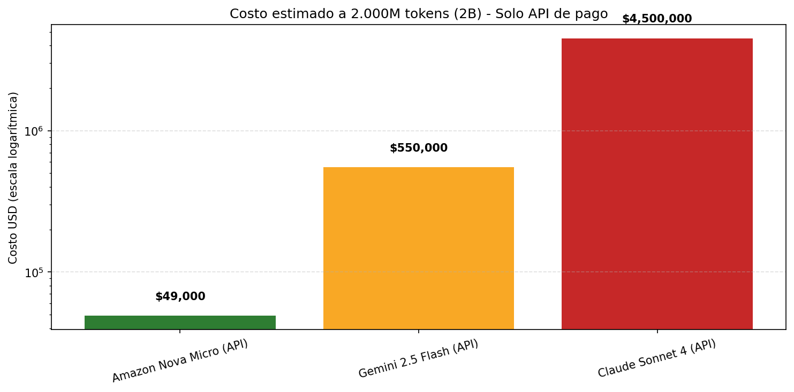

# 03 - Costos API vs Local 💰

## 💡 ¿Qué hace este programa?

Presentar reportes informativos de costos correspondientes al uso de IA
vía API o con uso de IA de forma local.

Esto con el ánimo de proyectar opciones para la toma de decisiones.
Se aclara que los valores son estimados y que la toma de decisión
no hace parte del análisis de los datos; es solo informativo para
quienes deban tomar la decisión.

> **⚠️ IMPORTANTE:** Este programa NO decide. Solo informa para que otros decidan.

## ⚙️ ¿Cómo lo hace?

### 1. Carga la información
Carga el archivo `matriz_costos_Final.xlsx` que tiene 3 hojas:

| Hoja | Contenido | ¿Para qué sirve? |
| :--- | :--- | :--- |
| **Hoja 1** | Costos Base | Costos fijos por cliente. Es la base para calcular todo lo demás. |
| **Hoja 2** | Tope Escalado - 2000 registros | Simulación de qué pasa si llegamos a 2000. Aquí se ve el tope donde ya no es rentable. |
| **Hoja 3** | Local vs API - Costo Oculto | Comparativo del costo real si lo hacemos local vs pagando la API. Aquí está el ahorro oculto. |

### 2. Comparativo a escala 2.000M (2B)

Aquí se ve la diferencia real. En proyecto chiquito todos valen casi $0,
a 2B la diferencia es de **$49 mil vs $4.5 millones**.

## 📊 Gráfica

### Costo estimado a 2.000M tokens (2B) - Solo API de pago

> **NOTA:** Valores estimados con fines comparativos, calculados el 5 de noviembre de 2026 con precios públicos de lista.
> Este gráfico compara COSTO, no CALIDAD. Nova es más económico para tareas simples. Claude es más costoso porque está diseñado para mayor razonamiento.

## 👔 Informe para el Jefe - Fuentes Oficiales

Precios públicos de lista consultados el **5 de noviembre de 2026**. Si el precio cambió hoy, es porque el proveedor lo cambió. Dele clic en **Verificar** y lo lleva directo a la página oficial.

| Modelo | Proveedor | Precio lista / 1M tokens | Verificar |
| :--- | :--- | :--- | :--- |
| Amazon Nova Micro | AWS Bedrock | $0.035 entrada / $0.14 salida | [Ver en AWS](https://aws.amazon.com/bedrock/pricing/) |
| Claude Sonnet 4 | Anthropic | $3 entrada / $15 salida | [Ver en Anthropic](https://www.anthropic.com/pricing) |
| Gemini 2.5 Flash | Google AI | $0.30 entrada / $2.50 salida | [Ver en Google](https://ai.google.dev/gemini-api/docs/pricing) |
| Llama 4 Scout / Gemma | Meta / Google - Abierto | $0 token, costo es servidor propio | [Ver Llama](https://www.llama.com/) |

> Nota: Valores estimados con fines comparativos. No incluye descuentos por batch, caché, impuestos ni costos de infraestructura.

También puede abrir el informe completo en HTML:
**`Comparativo Costos_para_el_jefe.html`**

## 📁 Archivos

*   `Comparativo Costos.ipynb` - Programa principal
*   `matriz_costos_Final.xlsx` - Matriz de costos con las 3 hojas
*   `grafica_2B.png` - Gráfica de costo a 2B tokens
*   `Comparativo Costos_para_el_jefe.html` - Informe bonito para el jefe
*   `README.md` - Este archivo
